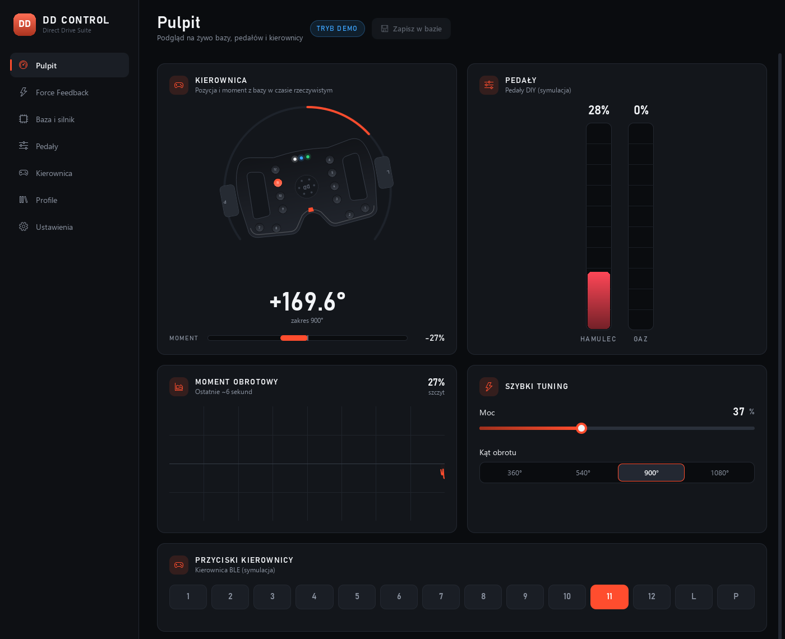
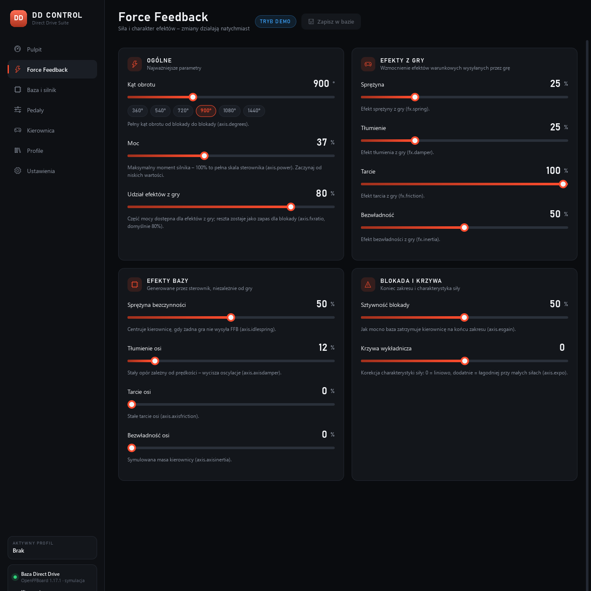
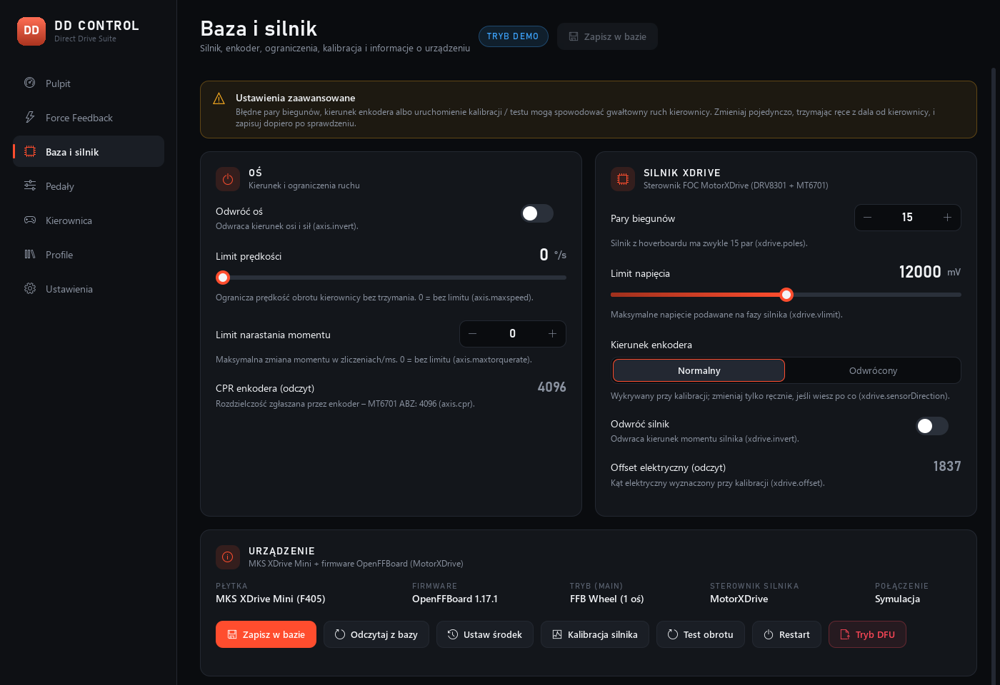
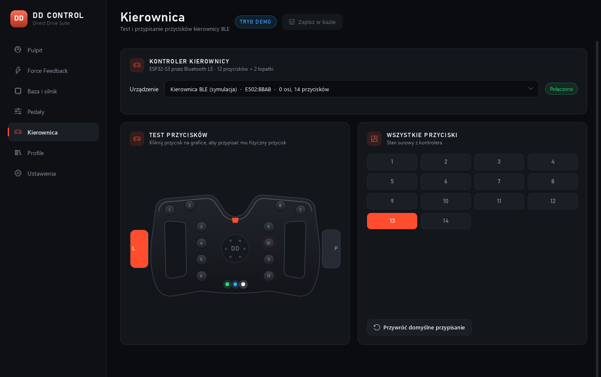

# DD Control

Aplikacja konfiguracyjna do zestawu **DIY Direct Drive** (baza na MKS XDrive Mini, kierownica BLE
i pedały na ESP32-S3). Ma interfejs w stylu aplikacji Fanatec: podgląd na żywo, strojenie
Force Feedback, ustawienia silnika i profile pod gry.

Obsługuje dwa firmware'y bazy i sama wykrywa, który jest podłączony:

| Firmware | Połączenie | Zastępuje |
| --- | --- | --- |
| **OpenFFBoard** (port na MKS XDrive Mini z klasą `MotorXDrive`) | wirtualny port COM (USB CDC), `1209:FFB0` | OpenFFBoard Configurator |
| **FFBeast** | USB HID, `1115:22999`, interfejs vendor | FFBeast Setup App |

Projekt: [sim-racing-setup-DIY](https://github.com/Camildo7/sim-racing-setup-DIY) – Politechnika Poznańska.



## Funkcje

| Strona | Co robi |
| --- | --- |
| **Pulpit** | Kierownica obracająca się na żywo, kąt, moment (pasek + wykres), pedały, przyciski, szybki tuning |
| **Force Feedback** | Kąt obrotu, moc / siła całkowita, efekty z gry, efekty bazy, blokada – zestaw pól zależy od firmware'u |
| **Baza i silnik** | Parametry osi i silnika, informacje o urządzeniu, zapis do flash, restart, DFU; dla OpenFFBoard także ustawienie środka, kalibracja (`xdrive.cal`) i test obrotu (`xdrive.test`) |
| **Pedały** | Podgląd gazu i hamulca, wybór osi, odwracanie, automatyczne wykrywanie osi („wciśnij pedał”) |
| **Kierownica** | Grafika kierownicy z 12 przyciskami + 2 łopatkami, test przycisków, przypisywanie przez kliknięcie |
| **Profile** | Wbudowane presety (iRacing, ACC, AC, F1, Drift, ETS2) i własne profile, osobno dla każdego firmware'u; porównanie z bieżącymi ustawieniami, eksport / import |
| **Ustawienia** | Tryb demo (symulacja całego sprzętu, do wyboru firmware), kolor akcentu |

Zmiany ustawień trafiają do bazy od razu (do RAM). **Zapisz w bazie** utrwala je w pamięci flash,
a **Cofnij** wczytuje z powrotem to, co jest w bazie.

## Uruchomienie

```bash
python -m pip install -r requirements.txt
python run.py            # normalnie - szuka bazy OpenFFBoard (COM) i FFBeast (HID)
python run.py --demo     # bez sprzętu: symulowana baza, pedały i kierownica
```

Gotowy plik `.exe` (folder `dist\DDControl`):

```bash
build.bat
```

Testy: `python -m pytest`

## OpenFFBoard

Komunikacja idzie przez ten sam wirtualny port COM i te same komendy tekstowe co w OpenFFBoard
Configurator (składnia z `CmdParser.cpp` / `CommandInterface.cpp` w repozytorium OpenFFBoard):

```
axis.0.power?            ->  [axis.0.power?|12000]
axis.0.degrees=900       ->  [axis.0.degrees=900|OK]
sys.0.lsactive?          ->  [sys.0.lsactive?|Axis:axis:0:2561:0\n...]
```

- Przy połączeniu aplikacja czyta `sys.swver`, `sys.hwtype`, `sys.main` i `sys.lsactive`, potem
  wszystkie ustawienia. Pole, na które firmware nie odpowiada (nieznana komenda), jest ukrywane.
- Pozycja i moment są odpytywane ~60 razy na sekundę (`axis.0.curpos?`, `axis.0.curtorque?`).
- **Windows pozwala otworzyć port COM tylko jednemu programowi**, więc DD Control i OpenFFBoard
  Configurator nie mogą działać jednocześnie. Oba programy dalej obsługują ten sam firmware.

### Kontrakt komend `xdrive` (do zaimplementowania w firmware)

Klasy `sys`, `axis` i `fx` to standardowe OpenFFBoard. Sterownik `MotorXDrive` ze specyfikacji
jest nowy, więc aplikacja zakłada, że zarejestruje on klasę o nazwie **`xdrive`** (instancja 0)
z poniższymi komendami (`registerCommand` w `MotorXDrive::registerCommands`):

| Komenda | Flagi | Typ / jednostka | Opis |
| --- | --- | --- | --- |
| `poles` | GET, SET | int, 1–64 | pary biegunów (hoverboard: 15) |
| `vlimit` | GET, SET | int, mV | maks. napięcie na fazach |
| `sensorDirection` | GET, SET | -1 / +1 | kierunek enkodera względem faz (wynik kalibracji) |
| `invert` | GET, SET | 0 / 1 | odwrócenie kierunku momentu |
| `offset` | GET | int | kąt elektryczny z kalibracji (tylko odczyt) |
| `cal` | GET (wykonanie) | – | kalibracja: ustawienie wirnika, wykrycie kierunku, zapis offsetu |
| `test` | GET (wykonanie) | – | autotest: +360°, −720°, +360° |

Klasa musi być widoczna w `sys.lsactive` jako `…:xdrive:0:…`. Jeśli firmware jej nie ma, aplikacja
działa dalej, tylko chowa sekcję „Silnik XDrive” oraz przyciski kalibracji i testu. Zmiana nazw
komend wymaga poprawki tylko w `ddcontrol/openffboard/driver.py`.

### Punkt 4 specyfikacji („Kompatybilność z PC”)

Ten punkt dotyczy firmware'u. DD Control pomaga go spełnić i sprawdzić:

- **port COM (CDC)** – aplikacja łączy się tym samym protokołem co OpenFFBoard Configurator, więc
  dobrze sprawdza port CDC; Configurator używa jednak więcej komend, dlatego warto go też raz
  uruchomić na gotowym firmware,
- **HID Gamepad z FFB** – wystawia go firmware; na pulpicie widać kąt i moment, które z niego wynikają,
- **DFU** – przycisk *Tryb DFU* wysyła `sys.dfu`, płytka uruchamia bootloader STM32, a plik
  `.hex` / `.bin` wgrywa się w STM32CubeProgrammer (USB). Bez aplikacji: przytrzymaj BOOT0,
  naciśnij i puść RESET, puść BOOT0.

## Jak to działa

```
ddcontrol/
├─ core.py           wspólne typy: opis pól/sekcji/akcji (FirmwareSpec) i wątek połączenia (BaseLink)
├─ openffboard/
│  ├─ protocol.py    komendy tekstowe i parser odpowiedzi [cmd|wartość]
│  ├─ driver.py      opis ustawień OpenFFBoard + połączenie przez port COM
│  └─ simulator.py   wirtualna płytka udająca port szeregowy
├─ ffbeast/
│  ├─ protocol.py    struktury i raporty HID FFBeast
│  ├─ driver.py      opis ustawień FFBeast + połączenie USB HID
│  └─ simulator.py   wirtualna baza udająca hid.device
├─ gamepads.py       pedały i kierownica przez WinMM (joyGetPosEx) + symulacja
├─ storage.py        konfiguracja i profile (osobno dla każdego firmware'u) w %APPDATA%\DDControl
├─ backend.py        QObject wystawiający dane i akcje do QML; wybiera aktywną bazę
├─ main.py           start aplikacji
└─ qml/              interfejs; strony FFB i Baza budują się z opisu firmware'u (SchemaCards)
```

Każdy firmware opisuje swoje ustawienia w Pythonie: pola z zakresami, jednostkami i opisami,
pogrupowane w sekcje. Interfejs rysuje z tego kafelki, suwaki, przełączniki i pola liczbowe, więc
dodanie parametru to jedna linijka w `driver.py`.

Wątek połączenia jest jedynym właścicielem urządzenia. Przy przeciąganiu suwaka do bazy leci tylko
ostatnia wartość, a ~0,4 s po serii zmian aplikacja odczytuje ustawienia z powrotem, żeby pokazać
to, co baza faktycznie przyjęła.

**FFBeast** – według [dokumentacji](https://ffbeast.github.io/docs/en/wheel_programming.html):
feature reporty `0x21`/`0x22` z ustawieniami, raport `0xA3` do zmiany pola i komend
(restart / zapis / DFU), raport wejściowy ze stanem.

**Pedały i kierownica** to zwykłe kontrolery gier Windows, więc aplikacja tylko je podgląda.
Kalibracja i martwe strefy zostają w firmware ESP32.

**Symulatory** implementują ten sam interfejs co prawdziwe urządzenie (`serial.Serial` / `hid.device`),
więc tryb demo i testy przechodzą przez dokładnie ten sam kod protokołu.

## Do sprawdzenia na prawdziwym sprzęcie

Oba protokoły są zaimplementowane według źródeł / dokumentacji i przetestowane na symulatorach,
ale nie z fizyczną bazą:

- **OpenFFBoard**: czy firmware odpowiada na komendy `xdrive` zgodnie z kontraktem powyżej; zakres
  `axis.power` dla MotorXDrive (aplikacja traktuje 32767 jako 100%).
- **FFBeast**: Report ID raportu stanu (dokumentacja go nie podaje; `python run.py -v` loguje
  pierwsze raporty) i maksymalny kąt obrotu przyjmowany przez firmware.
- Mapowanie osi pedałów i numeracja przycisków kierownicy – użyj „Wykryj oś” i przypisywania
  przycisków.
- Presety profili to punkty startowe, nie wartości zmierzone na tej bazie.

Pierwsze testy rób z niską mocą i rękami z dala od kierownicy, zwłaszcza przy kalibracji i teście obrotu.




